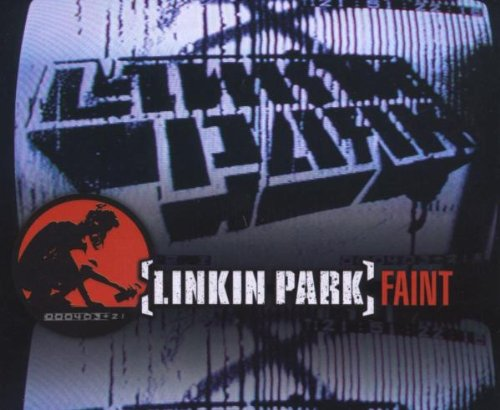

<!-- ========================================== -->
<!-- 🚀 DYNAMIC HEADER & TYPING ANIMATION       -->
<!-- ========================================== -->

  

  

    
  

  

---

<!-- ========================================== -->
<!-- 🧩 STATUS, LANGUAGES & INTERESTS           -->
<!-- ========================================== -->
<table border="0" width="100%">
  <tr>
    <td width="33%" align="center" valign="top">
      <h3>Status</h3>
      

          
          
        
      

    </td>
    <td width="33%" align="center" valign="top">
      <h3>Languages</h3>
      

          
          
        
      

    </td>
    <td width="34%" align="center" valign="top">
      <h3>Interests</h3>
      

          
          
        
      

    </td>
  </tr>
</table>

---

<!-- ========================================== -->
<!-- 🛠️ TECH STACK & SKILLS                     -->
<!-- ========================================== -->
### Tech Stack & Skills

<table border="0" width="100%">
  <tr>
    <td width="60%" valign="middle">
      <table border="0" width="100%">
        <tr>
          <td valign="middle"><b>Web Development</b></td>
          <td valign="middle">
            
             
            
            
          </td>
        </tr>
        <tr>
          <td valign="middle"><b>Systems & Networks</b></td>
          <td valign="middle">
            
             
            
             
            
          </td>
        </tr>
        <tr>
          <td valign="middle"><b>Tools & Environment</b></td>
          <td valign="middle">
            
             
            
            
          </td>
        </tr>
      </table>
    </td>
    <td width="40%" align="center" valign="middle">
      
    </td>
  </tr>
</table>

---

<!-- ========================================== -->
<!-- 📊 GITHUB STATS & ACTIVITY                 -->
<!-- ========================================== -->
### GitHub Stats & Activity

  <table border="0" width="100%">
    <tr>
      <td width="50%" align="center">
        
      </td>
      <td width="50%" align="center">
        
      </td>
    </tr>
    <tr>
      <td colspan="2" align="center">
        
      </td>
    </tr>
  </table>

<!-- ========================================== -->
<!-- 🐍 CONTRIBUTION SNAKE ANIMATION           -->
<!-- ========================================== -->

  <picture>
    <source media="(prefers-color-scheme: dark)" srcset="https://raw.githubusercontent.com/TiFoNN/TiFoNN/output/github-snake-dark.svg">
    <source media="(prefers-color-scheme: light)" srcset="https://raw.githubusercontent.com/TiFoNN/TiFoNN/output/github-snake.svg">
    
  </picture>

---

<!-- ========================================== -->
<!-- 🎵 CURRENTLY JAMMING / MUSIC CARD          -->
<!-- ========================================== -->

  ### On Repeat / Favorite Track

  <!-- SONG_START -->
  <table border="0">
    <tr>
      <td align="center" width="180" valign="middle">
        
      </td>
      <td valign="middle" align="left">
        <h2>Faint</h2>
        

          <b>Artist / Band:</b> Linkin Park  
          <b>Album:</b> Meteora
        

        
        &nbsp;&nbsp;
        
        &nbsp;
        
      </td>
    </tr>
  </table>
  <!-- SONG_END -->

---

<!-- ========================================== -->
<!-- 📬 CONNECT & SOCIALS                       -->
<!-- ========================================== -->

  
  &nbsp;&nbsp;
  

    

  <!-- WAVE FOOTER -->
  

