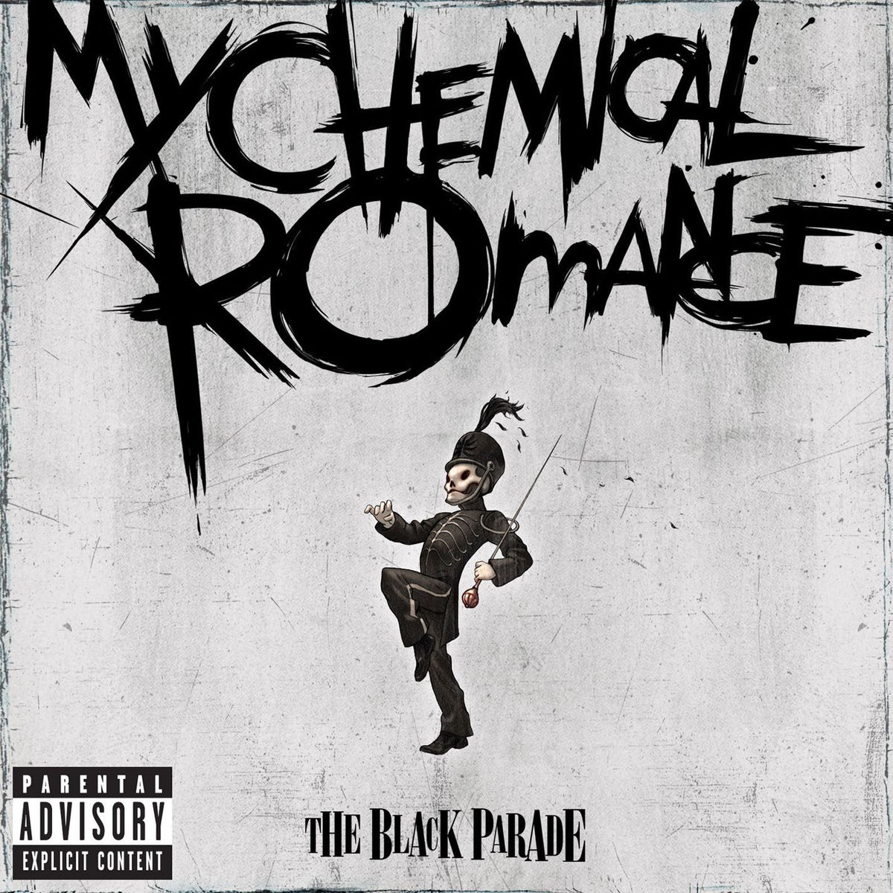

<!-- ========================================== -->
<!-- 🚀 DYNAMIC HEADER & TYPING ANIMATION       -->
<!-- ========================================== -->

  

  

    
  

  

  

    
    
    
  

---

<!-- ========================================== -->
<!-- 🌐 LANGUAGES                               -->
<!-- ========================================== -->
### Languages

  
  &nbsp;&nbsp;
  
  &nbsp;&nbsp;
  

---

<!-- ========================================== -->
<!-- 🛠️ TECH STACK & SKILLS                     -->
<!-- ========================================== -->
### 🛠️ Tech Stack & Skills

| Domain | Technologies & Tools |
| :--- | :--- |
| **Web Development** |     |
| **Systems & Networks** |      |
| **Tools & Environment** |     |

---

<!-- ========================================== -->
<!-- 📊 GITHUB STATS & ACTIVITY                 -->
<!-- ========================================== -->
### 📊 GitHub Stats & Activity

  <table border="0" width="100%">
    <tr>
      <td width="50%" align="center">
        
      </td>
      <td width="50%" align="center">
        
      </td>
    </tr>
    <tr>
      <td colspan="2" align="center">
        
      </td>
    </tr>
  </table>

<!-- ========================================== -->
<!-- 🐍 CONTRIBUTION SNAKE ANIMATION           -->
<!-- ========================================== -->

  <picture>
    <source media="(prefers-color-scheme: dark)" srcset="https://raw.githubusercontent.com/TiFoNN/TiFoNN/output/github-snake-dark.svg">
    <source media="(prefers-color-scheme: light)" srcset="https://raw.githubusercontent.com/TiFoNN/TiFoNN/output/github-snake.svg">
    
  </picture>

---

<!-- ========================================== -->
<!-- 🎵 CURRENTLY JAMMING / MUSIC CARD          -->
<!-- ========================================== -->

  ### On Repeat / Favorite Track

  <table border="0">
    <tr>
      <td align="center" width="180" valign="middle">
        
      </td>
      <td valign="middle" align="left">
        <h2>Welcome to the Black Parade</h2>
        

          <b>Artist / Band:</b> My Chemical Romance  
          <b>Album:</b> The Black Parade
        

        
        &nbsp;&nbsp;
        
        &nbsp;
        
      </td>
    </tr>
  </table>

---

<!-- ========================================== -->
<!-- 📬 CONNECT & SOCIALS                       -->
<!-- ========================================== -->

  
  &nbsp;&nbsp;
  

    

  <!-- WAVE FOOTER -->
  

